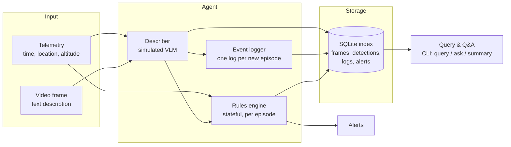
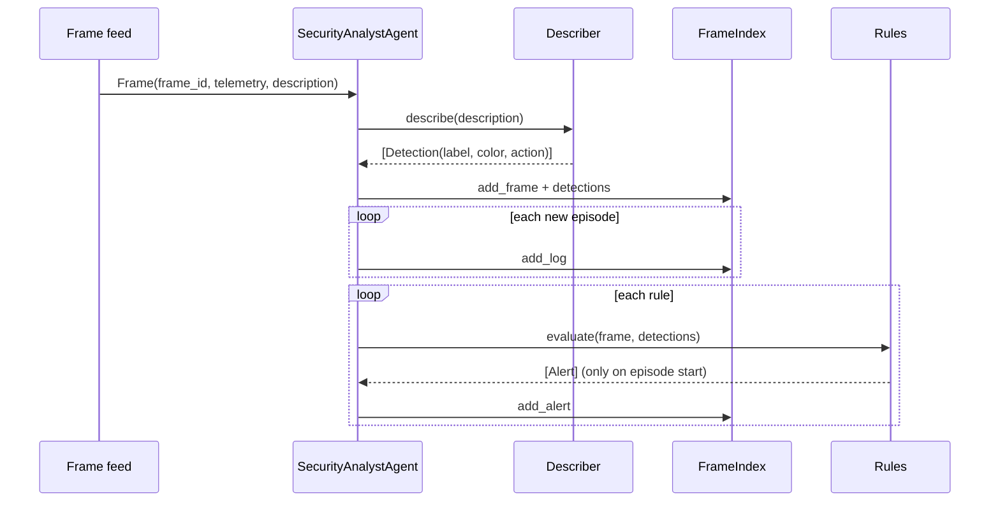

# Architecture

## Pipeline



## Per-frame sequence



## Components

| Component | File | Responsibility |
|---|---|---|
| Models | `drone_agent/models.py` | Typed data (`Frame`, `Telemetry`, `Detection`, `Alert`), time parsing, JSON loader |
| Describer | `drone_agent/describer.py` | Turns a frame description into detections. This is the swap point for a real VLM. |
| Rules | `drone_agent/rules.py` | Four predefined rules. `EpisodeTracker` makes each one fire once per episode. |
| Agent | `drone_agent/agent.py` | Runs the pipeline per frame and tracks episodes to decide what to log |
| Index | `drone_agent/indexer.py` | SQLite schema and query API (by time, location, object, colour, entries) |
| Q&A | `drone_agent/qa.py` | Rule-based answers to follow-up questions and the day summary |
| CLI | `drone_agent/cli.py` | `run`, `query`, `ask`, `summary` commands |

## Storage schema

```
frames      (frame_id PK, time, minute, location, altitude_m, description)
detections  (id PK, frame_id FK, label, color, action)      -- index on label
logs        (id PK, frame_id FK, time, minute, location, label, color, action, text)
alerts      (id PK, frame_id FK, time, location, rule, severity, message)
```

`minute` is stored alongside `time` ("HH:MM") so time-window queries compare integers.

## Key design choices

1. **Episodes instead of frames.** Logs and alerts fire when a condition starts, not on every
   frame. A key of `(label, colour, location)` identifies an object, and an episode ends when
   that key disappears from a frame.
2. **Stateful rules.** Each rule holds an `EpisodeTracker`. Loitering also tracks dwell time,
   measured from the first frame of the episode, so the alert fires once the person has been
   present for 10 minutes.
3. **Entry counting uses runs of frames.** "Entered twice" means two separate runs of
   `action = entering` frames for the same object and place. Consecutive frames form one run.
4. **Telemetry is a first-class input.** Altitude feeds a safety rule, and location feeds every
   zone-based rule.

## Scaling path (not built)

- Replace the describer with a batched VLM or detector, running on a GPU worker that reads from a queue.
- Add CLIP embeddings per frame to a vector index (FAISS or pgvector) for "find similar frames" search.
- Move SQLite to Postgres when multiple writers or a dashboard are needed. The schema carries over.
- Add an LLM in front of `qa.py` for free-form questions, with the index as its only data source,
  so answers stay grounded in stored rows.
